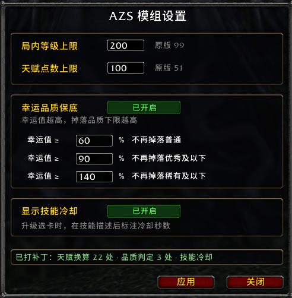

# AZS — Azerothian Zenith Suite

《Azeroth Survivors》的本地功能模组：把成长上限从固定刻度上拧下来，交给玩家自己校准。

泰坦为艾泽拉斯定下秩序，也给生灵的成长划好了刻度——99 级、51 点天赋、固定的
品质与冷却。这套「天顶套件」让这些数字可以由你调整。



> 本模组仅修改本地单机存档体验，不联网、不动多人数据。使用第三方模组的
> 风险自负；游戏更新后如遇失效，请回到本页下载新版。

## 功能一览

| 功能 | 说明 | 原版值 | 可配范围 |
|---|---|---|---|
| 局内等级上限 | 经验条到顶不再封在 99 级 | 99 | 默认 200，可配 |
| 天赋点数上限 | 突破 51 点的结构性上限 | 51 | 默认 100，3~127 |
| 幸运品质保底 | 幸运堆到阈值后不再掉低品质 | 无 | 60/90/140%，可关 |
| 冷却时间显示 | 升级选卡时，技能卡首行显示该技能冷却 | 无 | 开关 |
| 游戏内设置面板 | MODS → AZS，改完点「应用」立即生效并写回配置 | — | — |

## 安装

1. 到 **Releases** 页下载 `azs-mod-0.2.0.zip`，解压到**任意目录**：
   - `azs-launcher.exe`（启动器，负责注入）
   - `azs_mod.dll`（模组本体）
   - `azs-mod.toml.example`（配置模板）
2. 把 `azs-mod.toml.example` 改名为 `azs-mod.toml`（可跳过——没有该文件时
   模组用内置默认值）。
3. **双击 `azs-launcher.exe` 启动游戏**（不要直接双击游戏 exe——模组靠启动器
   注入）。游戏路径第一次会让你选，选完自动记住，之后免选。

## 游戏内面板

游戏右侧 **MODS → AZS** 打开设置面板，常用调整（等级/天赋上限、品质阈值、
冷却显示开关）不必改文件：面板里点「应用」立即生效，并写回 `azs-mod.toml`。

## 配置项

`azs-mod.toml` 是运行期文件（游戏内改设置时会被写回）。文件不存在时使用
下列内置默认值：

```toml
log           = false  # 诊断日志，排查问题时改 true
run_level_cap = 200    # 局内等级上限（原版 99）
talent_cap    = 100    # 天赋总点数上限（原版 51）

luck_quality  = true   # 幸运品质保底（默认开启）
luck_t1       = 60     # ≥60%：不再掉落普通
luck_t2       = 90     # ≥90%：不再掉落优秀及以下
luck_t3       = 140    # ≥140%：不再掉落稀有及以下

cooldown      = true   # 升级卡片在描述首行显示冷却（如「7秒冷却」）
```

推荐 `talent_cap` 取 3 的倍数（天赋按每层 3 系各 1 点发放）。

## 游戏自动更新

游戏内置更新器会先启动新版本进程、再退出旧进程。启动器在游戏运行期间持续
监视同名进程，发现新进程后立即注入模组 DLL，因此**更新重启后模组仍然生效**，
无需再次双击启动器。

如果游戏以管理员权限重启，启动器也需要以管理员权限运行，否则无法打开新进程。

## 许可与免责

本仓库仅含构建产物，供个人使用。模组与《Azeroth Survivors》本体及开发商
无任何关联；因使用本模组导致的存档、账号或其他损失由使用者自行承担。
